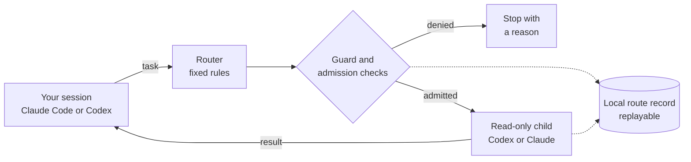

# Codex–Claude agent orchestration

[](https://github.com/Lyderies/codex-claude-agent-orchestration/actions/workflows/ci.yml)
[](LICENSE)

Let a Claude Code or Codex session hand bounded sub-tasks to Codex or Claude child agents, on subscription logins only.

**Status:** dogfood toolchain v1 (release 0.2.0, Codex package 0.8.10). Children are read-only.
macOS first, Linux partly untested, no Windows. Subscription logins only, never metered APIs.



In words: your session hands a task to the router. Guard and admission checks either stop it with a
reason or start one read-only Codex or Claude child. The route and the outcome are recorded locally and
can be replayed.

## Why

- **Code picks the child, not a model.** A route comes from the installed policy, the task and your
  project's committed configuration, in the [routing table](docs/routing-table.md)'s fixed order:
  quality first, then expected usage cost. Model output never grants tools, paths or spend.
- **Subscription logins only.** API keys, usage credits and paid fallback are never eligible, and no child
  runs until you have signed a billing attestation for that account.
- **Independent checking.** Each meaningful result goes to a verifier from the other provider when one is
  eligible, then to your project's own hashed test and security commands.
- **Evidence stays on your machine.** Routes, admission decisions and outcomes go to a local ledger in
  `~/.local/state/codex-agents` that is never committed, and every recorded route replays exactly.

It does not yet run children that can edit files, and it never changes its own routing without you.

## Quick start

You need:

- macOS, or Linux (WSL counts) without operational QA yet, with Git from the Command Line Tools, Xcode
  or Homebrew and Python 3.11 or later from a trusted install such as Homebrew or python.org;
- Claude Code 2.1.x, Codex CLI 0.164.0 or both, signed in with their subscriptions, and no API key in
  the environment;
- for a new project, an `operational-checks.json` naming its exact test and security commands
  ([recipe](docs/manual-setup.md#operational-checks)).

From the root of this repository:

```sh
./setup.sh /path/to/project
```

The wizard checks your machine, asks which providers children may use, installs into the project,
registers the local collector and hands you the billing attestation to sign. Run it again to update,
verify or re-attest. The [getting started](docs/getting-started.md) guide walks through a first run.

> [!CAUTION]
> Open Codex on the project itself. Never open it on a folder that contains a set-up project, on this
> repository, on your home folder, on a folder above it or on `/`. A session opened above a project
> could plant files that Codex runs outside its sandbox. [Why](docs/security-model.md#where-to-open-codex)

## Using it

**From Claude Code**, open the project and ask, for example: "Use the `agent-orchestration` skill to
have the routed reviewer check the error handling in `src/`." It routes the task, starts the child,
has the result verified, runs your checks and reports back.

**From Codex**, start `codex` (or `codex -p orchestrator`, if setup created that profile) in the
project's own folder from your own terminal, and ask for the `orchestrate-agents` skill.

A denied task comes back with a `reason_code` saying why. Your only command is `./setup.sh`; the
orchestrator CLI is for the agent, which runs it through the skill. More in
[using it](docs/using-it.md).

## Safety at a glance

- **Subscription only.** Admission fails closed on an API key in the environment, an unreviewed client
  version, unknown or paid-usage billing, a missing attestation or exhausted headroom, and checks
  again at launch.
- **Read-only children.** Every child is read-only. A bridged child sees only the committed files it was
  granted, in a private copy, under a hard deadline.
- **Results are bound.** A bridged child's result is validated and recorded by digest in the ledger,
  and only the verifier opened for that result counts.
- **Protected Codex commands.** The optional Codex rule runs a byte-verified, owner-only copy of the
  orchestrator, and its session guard refuses sessions that can write too much.
- **Your authority stays yours.** Setup and attestation run this repository's own code, never the
  project's, and only you can sign with your owner key.

Known limits include: Codex children can still read outside their export until G3, and a session that
can already write `~/.codex` can forge what the guard checks. The full list and the threat model are in
the [security model](docs/security-model.md).

> [!WARNING]
> The attestation is your own statement about your billing settings. Admission also checks what the
> clients report, but relies on extra usage and Codex credit purchases being off; re-attest whenever
> they change.

## Documentation

- [Getting started](docs/getting-started.md): from a fresh clone to a first routed review
- [Using it](docs/using-it.md): orchestrating from Claude Code and from Codex
- [Setup wizard](docs/setup-wizard.md) and [manual setup](docs/manual-setup.md)
- [Configuration](docs/configuration.md): project files, machine files and options
- [How it works](docs/how-it-works.md): routes, admission, children, verification and the ledger
- [Security model](docs/security-model.md): what v1 protects and what it does not
- [Troubleshooting](docs/troubleshooting.md) and [FAQ](docs/faq.md)
- [All documentation](docs/README.md)

## Roadmap

- **v1.1:** child liveness from real client events, so a silent child is noticed and stopped.
- **v1.2:** a Codex plan loop that keeps a Codex session working through a plan; code decides every stop.
- **Then G3 and G4:** children that can edit files in their own worktrees, then evidence-driven routing.

What changed in each release is in the [CHANGELOG](CHANGELOG.md).

## Contributing

See [CONTRIBUTING.md](CONTRIBUTING.md) for the branch model and the checks. Changes to authority,
containment or billing logic need an independent security review.

## Security

Report vulnerabilities privately as described in [SECURITY.md](SECURITY.md), not in public issues.

## License

[Apache License 2.0](LICENSE). See [NOTICE](NOTICE).
