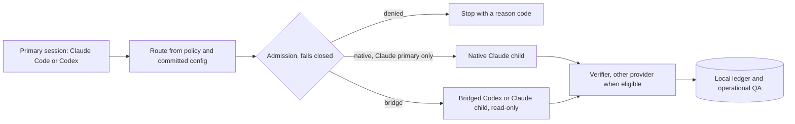
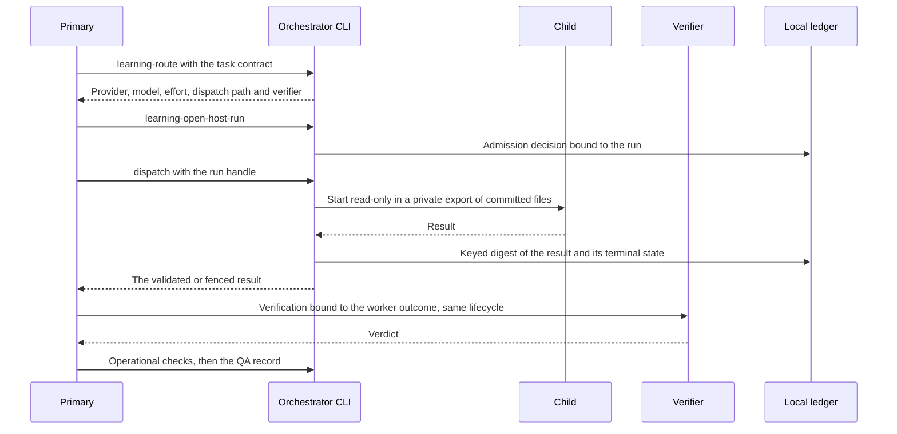
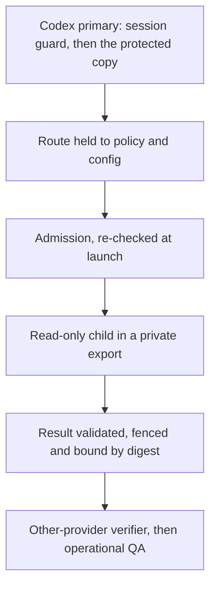
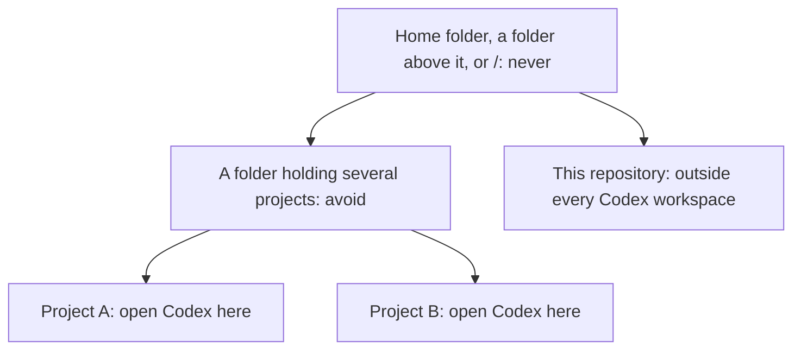

# Codex–Claude agent orchestration

Let a Claude Code or Codex session hand bounded sub-tasks to Codex or Claude child agents, on subscription logins only.

**Status:** release candidate for dogfood toolchain v1 (release 0.2.0, Codex package 0.8.9). Children are
read-only. macOS first, Linux partly untested, no Windows. Subscription logins only, never metered APIs.

[Safety model](#safety-model) · [Quick start](#quick-start) · [Plan](docs/delivery/plan.md) · [Design](docs/delivery/g2-design.md) · [Changelog](CHANGELOG.md) · [Security](SECURITY.md)



In words: the primary asks for a route, admission either stops the run or admits one read-only child, and
the result goes to a verifier (from the other provider when one is eligible), then to the ledger and QA.

## Why

- **Code picks the child, not a model.** A route is a pure function of the installed policy, the task
  contract and committed project configuration, in the [routing table](docs/routing-table.md)'s fixed
  order: quality first, then expected usage cost. Model output never grants tools, paths or spend.
- **Subscription logins only.** API keys, usage credits and paid fallback are never eligible, and no child
  runs until you have signed a billing attestation for that account.
- **Independent checking.** Each meaningful result goes to a verifier from the other provider when one is
  eligible, then to your project's own hashed test and security commands.
- **Evidence stays on your machine.** Routes, admission decisions and outcomes go to a local ledger that is
  never committed, and every recorded route replays exactly.

It does not yet run write-capable children, and it never changes its own routing without you.

## How it works

The **primary** is the session you work in; a **child** is an agent it delegates one bounded assignment
to. **Admission** is the deterministic gate that decides whether a child may start, and the **ledger** is
the local record that binds each run to its route, admission decision and result.



In words: route, open (admission), dispatch one child, record exactly the result it returned, verify it
through the same lifecycle, then run operational QA. A Claude primary spawns a Claude child natively with
the Agent tool instead, using spawn parameters the CLI computes ([G2 design](docs/delivery/g2-design.md)).

| Primary | Codex child | Claude child |
|---|---|---|
| Claude Code | Bridged: `codex exec`, read-only | Native subagent through the Agent tool |
| Codex | Bridged: `codex exec`, read-only | Bridged: `claude -p`, read-only, only if the project allows it |

## Safety model

What v1 enforces:

- **Subscription only.** Admission fails closed on an API key in the environment, an unreviewed client
  version, an identity reading over 30 minutes old, a non-subscription plan, a missing attestation,
  unknown or paid-usage billing, exhausted headroom (90% of a window) or a run cap, and re-checks at launch.
- **Owner-signed attestation.** Per account, you sign that extra usage and credit purchases are off, with
  your one passphrase-protected owner key; `attest.py` signs only the bytes it rebuilt from your answers.
- **Read-only children in a private export.** A bridged child sees only the committed bytes of its granted
  paths, under a hard deadline. Claude children get `Read`, `Glob` and `Grep` only; Codex children run
  `codex exec` read-only and ephemeral, without user config, execpolicy rules, approvals or connectors.
- **Results bound in the ledger.** `dispatch` fences an invalid result and binds a digest of the one it
  returns. QA accepts only the verifier opened for that outcome and runs only the project's hashed commands.
- **Protected command rule and session guard.** The optional Codex rule lets only the 23 everyday
  orchestrator commands run outside Codex's sandbox, through an owner-only, byte-verified runtime copy in
  `~/.codex`. Before each command the copy refuses a session that can write `/`, your home folder or a
  folder above it, `~/.codex`, this repository or a tool folder, or runs without its sandbox.
- **Owner authority stays with you.** `setup.sh`, `attest.py` and the installer run this repository's own
  CLI, never the project's copy; Git on the project is plumbing only; and the interpreter, Git and provider
  clients must come from trusted install folders.



In words: a request meets these layers in order, and a failure at any layer stops the run.

**Does not protect against** (full list: the residual risks in S4c, S5b and S6 of the
[G2 design](docs/delivery/g2-design.md)):

- **Codex reads.** Codex's read-only sandbox can read outside the export (enforced read roots come in G3).
  A native Claude child has the primary's permissions, so its reads are advisory.
- **A session that already writes `~/.codex`** (opened on `/`, or given it with `--add-dir`) can forge its
  own session record, the rule and the copy. The guard stops the ordinary mistake, not that.
- **Parent-folder sessions.** A session opened above the project can change its configuration and `.git`.
- **A primary that ignores its route.** A Codex primary can still spawn a native Codex child that shares
  its rule; a Claude primary's native children spend its own allowance whatever admission says.
- **Other spellings and detached processes.** The installer's Claude Code deny rules are a policy layer,
  so `bash -c` is not matched; a process that double-forks between snapshots can outlive cleanup.
- **Prompt content and a modified package.** Repository text reaches every child's prompt as instructions;
  the protected copy is checked against this package, not against a signature.

> [!WARNING]
> The attestation is your own statement about your billing settings. Admission also checks what the clients
> report, but relies on extra usage and Codex credit purchases being off; re-attest whenever they change.

## Quick start

You need macOS, or Linux (WSL counts) without operational QA yet; Git from the Command Line Tools, Xcode
or Homebrew (`/usr/bin/git` on Linux); Python 3.11+ from a trusted install such as Homebrew or python.org
first on `PATH` (not a virtual environment or macOS's `/usr/bin/python3` shim); and Claude Code 2.1.x,
Codex CLI 0.164.0 or both, signed in with their subscriptions, with no API key in the environment.

> [!NOTE]
> A new project needs a prepared `operational-checks.json` naming its exact, hashed test and security
> commands. The wizard asks for its path; see the [recipe](docs/manual-setup.md#operational-checks).

```sh
./setup.sh /path/to/project    # from the root of this repository
```

| Step | What it does |
|---|---|
| 1. Checks | The OS, Git, a trusted Python, both sign-ins, no API key, and recent Codex sessions that could write too much |
| 2. Project | Picks the project (top of a Git working tree) and previews the install; changes nothing |
| 3. Providers | Codex children, Claude children and models, and whether Codex sessions may start Claude children |
| 4. Install | Installs, writes `provider-routing.json`, offers to commit only the changed files (never pushed), verifies |
| 5. Collector | Registers the project with the local learning collector and starts it |
| 6. Billing | Hands the terminal to `attest.py`, which only you can complete |
| 7. Profile | Only if Codex sessions may start Claude children: the `codex -p orchestrator` profile, network on |
| 8. Commands | Only if Codex sessions orchestrate the project: the Codex commands rule and its protected copy |
| 9. Done | A line per step, how to start in each client, and the remove command |

Keys: arrows, Enter, Space, `q` to quit; `NO_COLOR=1` for plain output. Run it again to update, verify,
re-attest or change the owner key passphrase. Details: [setup wizard](docs/setup-wizard.md) and
[manual setup](docs/manual-setup.md).

### Where to open Codex

Open Codex on your project folders, not on a folder that holds them all.



In words: open Codex on each project folder; never on the home folder, a folder above it or `/`; avoid a
folder that holds several projects; and keep this repository outside every folder you open in Codex.

> [!CAUTION]
> Never add `~` or `~/.codex` with `--add-dir` either. Setup warns about recent Codex sessions that could
> write those folders, this repository or a tool folder, and the orchestrator refuses their commands.

## Using it

**From Claude Code**, open the project and ask, for example: "Use the agent-orchestration skill to have the
routed reviewer check the error handling in `src/`." It routes, opens the run, spawns a Claude child or
dispatches a Codex child, verifies, runs operational QA and reports. A denial comes back as a `reason_code`.

**From Codex**, start a session in the project's own folder with `codex -p orchestrator` if step 7 created
the profile, otherwise `codex`, and ask for the `orchestrate-agents` skill. It first runs `host-command`
and stops, with the reason, unless the commands rule is `installed` and the session guard says `ok`.

## Configuration

| File (in the project) | Purpose |
|---|---|
| `.codex/orchestration/provider-routing.json` | Enabled providers, allowed Claude models, and `codex_primary_may_bridge_to_claude`. Committed and clean; without it only Codex children are allowed |
| `.codex/orchestration/operational-checks.json` | The exact, hashed test and security commands operational QA may run |
| `.codex/orchestration/project-agent-routing.json` | Optional mapping of project agents to task families; setup writes an empty one if missing |
| [`docs/routing-table.md`](docs/routing-table.md) (this repository) | The starting table; the policy mirrors it, and a test holds the policy to its order |

## Troubleshooting

<details><summary>"That passphrase did not unlock the key."</summary>

`attest.py` asks `Try again or Exit? [T/e]`; press Enter to try again.
</details>
<details><summary>I lost my owner key passphrase</summary>

Signed attestations stay valid (admission uses the latest per account), but you cannot sign new ones: owner
key rotation is not available yet. To stop a provider's children, disable it in `provider-routing.json`.
</details>
<details><summary>Codex reports the collector unreachable or "filesystem operation failed"</summary>

The command ran inside Codex's sandbox. Run `./setup.sh`, choose "Update the install and walk through every
step", allow the rule in step 8 (Commands), then start a new Codex session in the project's folder.
</details>
<details><summary>The Codex rule is "stale" after a Python or package upgrade</summary>

The rule names the exact Python build and runtime copy. Run `./setup.sh` again and choose "Replace it".
</details>
<details><summary>"This Codex session can write to ..."</summary>

The session guard refused the command. Quit that session and start Codex in the project's own folder.
"Run Codex without --ephemeral" means the session left no record to check.
</details>
<details><summary>The Codex rule is "unsupported"</summary>

It works only in your account's real `~/.codex`: set `HOME` to your own home folder, unset `CODEX_HOME`
(or point it at `~/.codex`), replace a symlinked `~/.codex` with a real folder, and run `./setup.sh` again.
</details>

## Status and roadmap

Toolchain v1 is G1 plus G2; native Windows support and operational QA on Linux are parked. See the
[delivery plan](docs/delivery/plan.md).

| Goal | Scope | Status |
|---|---|---|
| G1 | Import both packages; one-command install, verify and remove | Shipped (0.1.0) |
| G2 | Cross-provider read-only routing, admission, bridge, both primaries | Release candidate for toolchain v1 (0.2.0) |
| v1.1 | Child liveness from real client events: reasoning summaries on, a silent child graded stale, the primary decides, abort after a long silence, the hard deadline as backstop | Planned |
| G3 | Write-capable children in their own worktrees, verified by the other provider; enforced Codex read roots | Planned |
| G4 | Evidence-driven routing: paired runs, a frozen evaluation set, a usage-cost model, headroom tie-breaking | Planned |

## Development

```sh
git config core.hooksPath .githooks          # identifier guard on every commit
python3 scripts/check_identifiers.py         # scan tracked files
ruff check .
python3 -m unittest discover -s tests -v
(cd packages/codex-agents && python3 -m unittest discover -s tests)
(cd packages/claude-agents && PYTHONPATH=src python3 -m unittest discover -s tests)
```

CI runs the identifier guard, Ruff and all three suites on Linux and macOS. Every runtime change needs a
Codex package version bump and an entry in `packages/codex-agents/runtime-releases.json`.

## Contributing

There is no contributing guide yet; open an issue before sending a pull request. Changes to authority,
containment or billing logic need an independent security review; everything else needs tests, Ruff and a
clean identifier scan.

## Security

Report vulnerabilities privately as described in [SECURITY.md](SECURITY.md), not in public issues.

## License

[Apache License 2.0](LICENSE). See [NOTICE](NOTICE).
