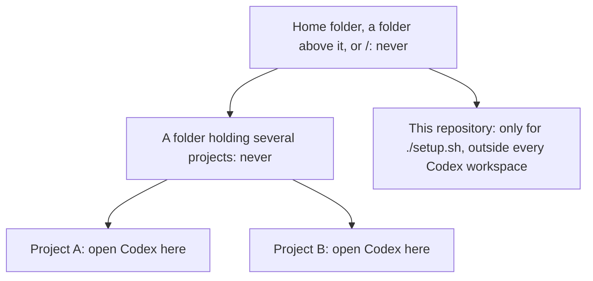

# Getting started

This walks you from a fresh clone to a first routed review in one project. It takes one run of the setup
wizard and one request in Claude Code or Codex.

## 1. Check the requirements

- **System:** macOS, or Linux (WSL counts) without operational QA yet. Windows is not supported.
- **Git:** from the Command Line Tools, Xcode or Homebrew (`/usr/bin/git` on Linux).
- **Python:** 3.11 or later from a trusted install such as Homebrew or python.org, first on `PATH`. Not a
  virtual environment, and not macOS's `/usr/bin/python3` shim.
- **Clients:** Claude Code 2.1.x, Codex CLI 0.164.0 or both, signed in with their subscriptions.
- **No API keys:** `ANTHROPIC_API_KEY` and `OPENAI_API_KEY` must not be set.

## 2. Clone this repository

Clone it somewhere outside every folder you open in Codex. You will only ever run `./setup.sh` from it;
never open Codex on it.

```sh
git clone https://github.com/Lyderies/codex-claude-agent-orchestration.git
cd codex-claude-agent-orchestration
```

## 3. Prepare the operational checks

A project that has never been set up needs an `operational-checks.json`. It names the exact test and
security commands, with their hashes, that operational QA may run, and it cannot be guessed. Follow the
short [recipe](manual-setup.md#operational-checks): two small wrapper scripts, committed in the project,
and their hashes. The recipe writes the file beside the project; the wizard asks for its path.

## 4. Run the wizard

Close every Codex session in the project first. Then, from the root of this repository:

```sh
./setup.sh /path/to/project
```

Use the arrow keys, Enter and Space; `q` quits.

| Step | What it does |
|---|---|
| 1. Checks | The OS, Git, a trusted Python, both sign-ins, no API key, and recent Codex sessions that could write too much |
| 2. Project | Picks the project (top of a Git working tree) and previews the install; changes nothing |
| 3. Providers | Codex children, Claude children and models, and whether Codex sessions may start Claude children |
| 4. Install | Installs, writes `provider-routing.json`, offers to commit only the changed files (never pushed), verifies |
| 5. Collector | Registers the project with the local learning collector and starts it; on macOS it first asks to move your records to `~/.local/state/codex-agents`, once |
| 6. Billing | Hands the terminal to `attest.py`, which only you can complete |
| 7. Profile | Only if Codex sessions may start Claude children: the `codex -p orchestrator` profile, network on |
| 8. Commands | Only if Codex sessions orchestrate the project: the Codex commands rule and its protected copy |
| 9. Done | A line per step, how to start in each client, and the remove command |

Two steps need you:

- **Hooks (step 4).** When the step says so, open `/hooks` in Codex and trust the orchestrator's learning
  hooks. Codex trusts hooks by hash, and setup never writes that trust.
- **Billing (step 6).** You confirm that each account cannot be charged beyond its subscription, and sign
  that with your passphrase-protected owner key. No child runs until you do.

For Codex sessions, allow the commands rule in step 8: the default there is "No, not now", so press Down
once to "Yes, allow these commands" before Enter. Every step is described in the
[setup wizard reference](setup-wizard.md).

## 5. Open the project in the right place

Open Codex on the project itself, never on a folder above it.



In words: open Codex on each project itself; never on a folder that contains a set-up project, this
repository, the home folder, a folder above it or `/`. Never add `~`, `~/.codex` or `~/.local` with
`--add-dir` either. The [security model](security-model.md#where-to-open-codex) explains why.

## 6. Ask for a first routed review

- **Claude Code:** open the project and ask: "Use the agent-orchestration skill to have the routed
  reviewer check the error handling in `src/`."
- **Codex:** from your own terminal, in the project's folder, start `codex -p orchestrator` (if step 7
  created the profile) or `codex`, and ask for the `orchestrate-agents` skill with the same request.

The primary routes the task, opens the run, starts a read-only child, has the result verified, runs your
operational checks and reports back. If something is refused, the answer carries a `reason_code`; see
[troubleshooting](troubleshooting.md).

## Next

- [Using it](using-it.md) for day-to-day use.
- [How it works](how-it-works.md) for what happened in that run.
- [Security model](security-model.md) for what is and is not protected.
