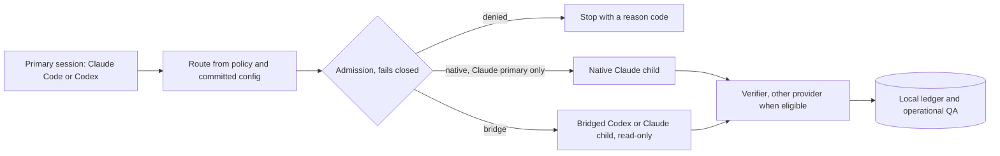
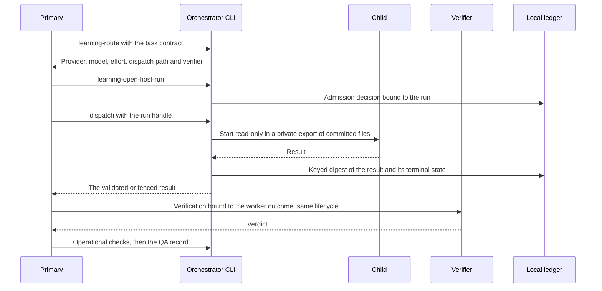

# How it works

## Terms

- The **primary** is the session you work in: Claude Code or Codex.
- A **child** is an agent the primary delegates one bounded assignment to.
- **Admission** is the deterministic gate that decides whether a child may start.
- The **ledger** is the local record that binds each run to its route, admission decision and result.
- The **verifier** is a second child that checks a meaningful result, from the other provider when one
  is eligible.
- **Operational QA** runs your project's own hashed test and security commands.

## The flow

In words: the primary asks for a route, admission either stops the run or admits one read-only child, and
the result goes to a verifier (from the other provider when one is eligible), then to the ledger and QA.

## Routing

A route is a pure function of the installed policy, the task contract and your project's committed
configuration. It names the provider, model, effort, dispatch path and verifier. The order comes from
the [routing table](routing-table.md): quality first, then expected usage cost per finished task. Model
output never grants tools, paths or spend, and the table changes only when recorded evidence justifies
it. Which providers and Claude models children may use is set per project in
`provider-routing.json` (see [configuration](configuration.md)).

## One run, step by step

In words: route, open (admission), dispatch one child, record exactly the result it returned, verify it
through the same lifecycle, then run operational QA. A Claude primary spawns a Claude child natively with
the Agent tool instead, using spawn parameters the CLI computes.

## Dispatch paths

| Primary | Codex child | Claude child |
|---|---|---|
| Claude Code | Bridged: `codex exec`, read-only | Native subagent through the Agent tool |
| Codex | Bridged: `codex exec`, read-only | Bridged: `claude -p`, read-only, only if the project allows it |

- **Bridged children** run in a private export of the committed bytes of their granted paths, under a
  hard deadline. The bridge validates the result, fences one that does not validate or is too large to
  keep, and records a keyed digest of what it returns, never its text.
- **Every Codex child is bridged**, from either primary, so no Codex child shares a Codex primary's
  session or its command rule.
- **Native Claude children** run in the Claude primary's own session and allowance. Admission still
  applies to them as accounting and policy, not as a spend boundary.
- **A Codex primary reaches Claude children** only when the project sets
  `codex_primary_may_bridge_to_claude` and the session was started with `codex -p orchestrator`, the
  profile that turns sandbox network on. Ordinary Codex sessions keep network off.

## The ledger and replay

Routes, admission decisions and outcomes go to a local ledger in `~/.local/state/codex-agents`, shared by
every project on the machine through one local learning collector. It is never committed, and every
recorded route replays exactly. A Codex primary reaches the collector through the Codex commands rule,
which runs a protected copy of the orchestrator outside Codex's sandbox; see the
[security model](security-model.md#the-protected-copy-and-the-codex-rule).

## Where the code lives

| Path | Contents |
|---|---|
| `setup.sh` | The setup wizard |
| `scripts/install.py`, `scripts/attest.py` | The installer and the billing attestation |
| `packages/codex-agents/` | The Codex orchestration package: agents, skills, hooks, routing, contracts, the learning ledger and operational QA |
| `packages/claude-agents/` | The Claude agent package: roles, contracts, validation, the installer, and the stream and usage parsers |

[`packages/README.md`](../packages/README.md) describes the two packages and where they came from.
