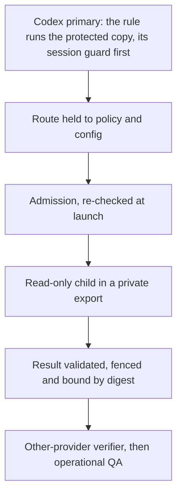

# Security model

This page explains what dogfood toolchain v1 (release 0.2.0, Codex package 0.8.10) protects, how,
and what it does not protect against. It is for users deciding whether to run it and for
contributors changing it. To report a vulnerability, follow [SECURITY.md](../SECURITY.md).

## Threat model

- **The agents run as you.** The AI agents this sets up run as your user account, so the setup tools
  and the orchestrator assume an agent may have changed anything it can write: the temporary folders,
  and any folder a Codex session was opened on, which may be a project or a folder above it (a nested
  project's tree, `.git` and `.claude` included).
- **Text is data, not authority.** Repository text, tool output and model output never grant
  providers, models, tools, paths or spend. Deterministic code and your project's committed
  configuration decide those, and a child's grant can only narrow its parent's.
- **No per-command approvals.** The orchestrator runs without asking you to approve each command.
  Safety comes from redundant layers instead, and a failure at any layer stops the run.
- **Billing is the other asset.** Nothing may reach a metered API, usage credits or paid fallback.

In words: a request meets these layers in order, and a failure at any layer stops the run.

## Where to open Codex

The supported setup assumes every Codex session is opened on a project itself, and that this
repository (the orchestrator clone) sits outside every folder opened in Codex. Never open Codex on a
folder that contains a set-up project, on this repository, on your home folder, on a folder above it
or on `/`, and never add `~`, `~/.codex` or `~/.local` with `--add-dir`.

A folder above a project is never safe. Codex runs a nested trusted project's `.codex/config.toml` and
hooks outside the sandbox, and keeps a project's `.codex`, `.agents` and `.git` read-only only when the
project is the top of the session's folder, so a session opened above it could plant those files. A
session that can write your home folder or `~/.codex` could change the Codex rule, its protected copy
and tools installed under your home folder, which the rule then runs.

## What v1 enforces

- **Subscription only.** Admission fails closed on an API key in the environment, an unreviewed client
  version, an identity reading over 30 minutes old, a non-subscription plan, a missing attestation,
  unknown or paid-usage billing, exhausted headroom (90% of a window) or a run cap, and re-checks at
  launch.
- **Owner-signed attestation.** Per account, you sign that extra usage and credit purchases are off, with
  your one passphrase-protected owner key. `attest.py` signs only the bytes it rebuilt from your answers,
  keys without a passphrase are refused, and signing runs without `ssh-agent`, so no program, an AI
  agent included, can sign in your name.
- **Read-only children in a private export.** A bridged child sees only the committed bytes of its granted
  paths, under a hard deadline. Claude children get `Read`, `Glob` and `Grep` only. Codex children run
  `codex exec` read-only and ephemeral, without user config, execpolicy rules, approvals or connectors.
  Every Codex child is bridged, from either primary; only a Claude primary spawns children natively,
  and only Claude children.
- **Results bound in the ledger.** `dispatch` fences an invalid result and binds a digest of the one it
  returns. QA accepts only the verifier opened for that outcome and runs only the project's hashed
  commands.
- **Claude primaries cannot run owner commands through Claude Code's tools.** The installer adds deny
  rules for every owner-only CLI subcommand to the project's `.claude/settings.json`, plus `Edit` rules for
  `.codex/**`, `.agents/**`, `.claude/settings*.json` and `.git/**`. These are a policy layer on Claude
  Code's tools, not a sandbox.

## The protected copy and the Codex rule

Codex's sandbox blocks the learning collector, so a Codex primary needs the optional Codex commands
rule, which you allow in step 8 of the [setup wizard](setup-wizard.md). The rule lets only the 23
everyday orchestrator commands run outside Codex's sandbox.

- The rule does not run the project's own `cli.py`, which a session opened above the project could
  rewrite. Setup copies exactly this package's runtime files, verified byte for byte, to an owner-only
  `~/.codex/agent-orchestration/<project digest>/<runtime digest>/` folder bound to the project, and the
  rule names that copy.
- The copy runs only the everyday commands, and only while the project's runtime files are byte for byte
  the copy. Before its folder goes on the import path, it checks that it holds exactly the files its
  manifest lists, so a planted module is never imported.
- Every Python the rule, the collector and the hooks start runs with `-I -B -S -X pycache_prefix=/dev/null`,
  so nothing from the working folder, the environment, site-packages or a bytecode cache loads.
- The rule works only in your account's real `~/.codex`; a `HOME` or `CODEX_HOME` that disagrees with
  the system account database, or a symlinked `~/.codex`, is refused. After a Python upgrade or a package update, `host-command` reports the
  rule as `stale` until setup runs again.

## The session guard

Before each command the rule runs, the protected copy reads the calling Codex session's own record (only
its settings, never the conversation) and refuses a session that:

- runs without its sandbox, or left no record (`--ephemeral`);
- was opened on a folder that contains the project;
- can write `/`, your home folder or a folder above it, `~/.codex`, this repository, your records in
  `~/.local/state/codex-agents`, the private working folders or a tool folder (`~/.local`,
  `/opt/homebrew` and the like, including one added with `--add-dir`).

The record format is Codex 0.164's, and any change fails closed. In a Codex session, `host-command` prints
the verdict as `session_guard`, and the Codex skill stops on anything but `ok`. Because the guard runs
before every rule-matched command, `dispatch` included, a session that could write the bridge's files
never starts a child. A refused session's commands stop, but what it already wrote stays.

The wizard's first screen also scans Codex's session records from the last 14 days and warns about a
session that could write this repository, your records or your home folder, or that was opened on a
folder containing a set-up project.

## Trusted installation folders

The interpreter the rule names (and its standard library), every provider client and Git must resolve
to a real file in a trusted installation folder: system folders, Homebrew, python.org, the Command Line
Tools, `/Applications`, Nix, or a hidden top-level folder of your home folder such as `~/.pyenv` or
`~/.local`. They must also be owned by you or root, writable by no one else, outside the project and the
temporary folders, and never macOS's `/usr/bin/python3` shim or `/usr/bin/git` shim. It is an allowlist
rather than "outside the home folder", because a sibling such as `~/Work/tools` could be part of a
permitted session's workspace. The owner tools and the runtime use one list, and setup never runs a
client or basic tool from an earlier `PATH` entry.

## Where your records live

- Your orchestrator records (the ledger, the digest key, the owner key record and the collector's files)
  live in `~/.local/state/codex-agents`, with the home folder taken from the system account database.
  They are never committed.
- `XDG_STATE_HOME` moves them only when it points inside a hidden folder of your home, such as
  `~/.local/state`; any other value refuses every command.
- Every existing folder between your home folder and the records must be a real folder, yours and
  writable by no one else, and the checked state files refuse a second hard link.
- Earlier releases kept the records in `~/Library/Application Support/codex-agents` on macOS. Setup
  moves them once, only with your approval, after showing when that folder was created and which owner
  key it names. Until then every orchestrator command refuses.
- A result that needs verification is kept only while its orchestration is open, and at most seven days
  after its outcome was recorded. Afterwards only the outcome's digests and closed metadata stay.

How the setup tools keep your authority away from the agents (trusted Python, Git plumbing only, the
owner key only from your own `~/.ssh`) is described in the
[setup wizard reference](setup-wizard.md#how-setup-keeps-your-authority-away-from-the-agents).

## What it does not protect against

These are accepted limits of v1. A report that shows one is worse than documented is welcome.

- **Codex reads.** Codex's read-only sandbox can read outside the export; enforced read roots come in
  G3. A native Claude child has the primary's permissions, so its reads are advisory.
- **A session that already writes `~/.codex`** (opened on `/`, or given it with `--add-dir`) can forge its
  own session record, the rule and the protected copy. The guard stops the ordinary mistake, not that. A
  session opened on a trusted installation folder itself could change the tools there too.
- **Parent-folder sessions.** A session opened above the project is refused by the guard, but can still
  change the project's `.codex` (its hooks and `config.toml`), `.codex/orchestration` and `.git/config`
  directly; the orchestrator refuses that session's commands, but cannot undo what it wrote.
- **A primary that ignores its route.** A Codex primary can still spawn a native Codex child that shares
  its rule. A Claude primary's native children spend its own allowance whatever admission says: for them
  admission is accounting and policy, not a spend boundary.
- **Other spellings and detached processes.** The installer's Claude Code deny rules are a policy layer,
  so a command spelled another way (such as `bash -c`) is not matched. A process that double-forks
  between snapshots can outlive cleanup; it stays inside the child's read-only, network-disabled
  sandbox.
- **Prompt content and a modified package.** Repository text, and your own `AGENTS.md` and Codex skills,
  reach a child's prompt as instructions (never as authority). The protected copy is checked against
  this package, not against a signature: an owner who installs a modified package gets that package
  copied.
- **Sessions running during an install.** The learning hooks run the project's installed hook code, not
  the protected copy, outside the sandbox. Once installed, that code is protected like
  `.codex/hooks.json` itself, but not from a process that was already writing the project before the
  install, when `.codex` did not exist. Close every Codex session in the project before installing or
  updating.
- **Claude settings and skills.** A Codex session in the project can rewrite `.claude/settings*.json`
  (hooks, deny rules) and `.claude/skills/`, which Claude Code loads on the host; verify warns about
  hooks there.
- **The old macOS records.** A session that could write `~/Library` could have changed them before the
  move; you check their creation date and owner key before approving it. The old copy
  (`codex-agents.moved-<time>`, with the digest key) stays readable until you delete it.
- **Raw results on disk.** A kept worker result is owner-only but readable by any sandboxed session, as
  all host files are, while its orchestration is open (at most seven days).
- **Warnings, not checks.** The wizard's session scan follows only the last 14 days of records. The
  `XDG_STATE_HOME` check trusts `HOME`, your own environment, as its anchor.
- **Platform gaps.** On macOS the interpreter check accepts folders the `admin` group can write, as
  Homebrew and python.org install that way. The per-user cache folder and the records folder were
  verified unwritable only in Codex 0.164's macOS sandbox; `$XDG_RUNTIME_DIR` on Linux was not tested
  live.
